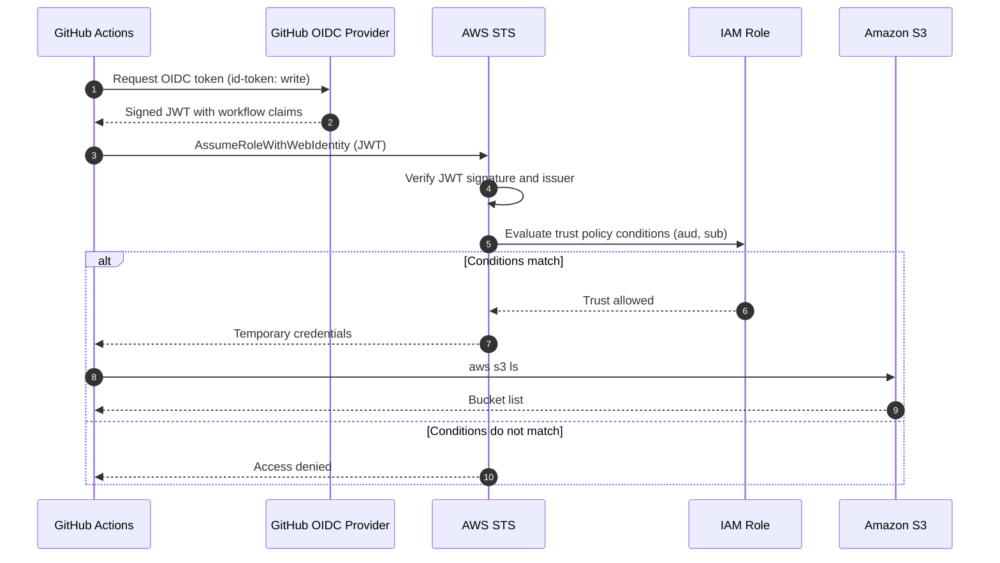

# GitHub Actions → AWS OIDC Demo

A minimal demo of how GitHub Actions authenticates to AWS using OpenID Connect (OIDC).

This demo does **not** store an AWS Access Key ID or Secret Access Key in GitHub Secrets. Instead, the workflow exchanges a short-lived GitHub-issued token for temporary AWS credentials.

```text
GitHub Actions
      ↓
GitHub OIDC token 
      ↓
AWS STS (AssumeRoleWithWebIdentity)
      ↓
IAM role trust policy evaluated
      ↓
Temporary AWS credentials
      ↓
AWS CLI commands
```

The workflow runs:

```bash
aws sts get-caller-identity
aws s3 ls
```

---

## Why OIDC?

The traditional approach is to create an IAM user and store its keys in GitHub Secrets:

```text
AWS_ACCESS_KEY_ID
AWS_SECRET_ACCESS_KEY
```

These are long-lived credentials. If they leak, they remain valid until someone rotates or disables them, and that rotation is a manual, ongoing burden.

With OIDC, no AWS key is stored anywhere. Each workflow run receives a short-lived token that AWS validates against a trust policy, and AWS issues temporary credentials that expire on their own.

Official documentation:

- [OpenID Connect in GitHub Actions](https://docs.github.com/en/actions/concepts/security/openid-connect)
- [Configuring OIDC in AWS](https://docs.github.com/en/actions/how-tos/secure-your-work/security-harden-deployments/oidc-in-aws)

---

## How It Works



### Flow summary

1. A workflow run starts, and GitHub issues it an OIDC JWT. The workflow needs `id-token: write` to request one.
2. The `aws-actions/configure-aws-credentials` action sends the JWT to AWS STS and asks to assume the IAM role.
3. STS verifies the token's signature and issuer, then evaluates the role's trust policy. The `aud` and `sub` conditions determine whether this specific repository and environment may assume the role.
4. If the conditions match, STS returns temporary credentials that the job uses for the AWS CLI.

---

## Repository Setup

### Step 1: Create the OIDC identity provider in AWS

In the AWS console, go to **IAM → Identity providers → Add provider** and choose **OpenID Connect**:

| Field | Value |
|---|---|
| Provider URL | `https://token.actions.githubusercontent.com` |
| Audience | `sts.amazonaws.com` |

AWS manages certificate validation for GitHub's OIDC endpoint, so you don't need to rotate a thumbprint as routine maintenance.

### Step 2: Create the IAM role

Create a role named `GitHubActionsS3DemoRole` with the OIDC provider as the trusted entity. Use this trust policy, replacing the placeholders:

```json
{
  "Version": "2012-10-17",
  "Statement": [
    {
      "Effect": "Allow",
      "Principal": {
        "Federated": "arn:aws:iam::<AWS_ACCOUNT_ID>:oidc-provider/token.actions.githubusercontent.com"
      },
      "Action": "sts:AssumeRoleWithWebIdentity",
      "Condition": {
        "StringEquals": {
          "token.actions.githubusercontent.com:aud": "sts.amazonaws.com",
          "token.actions.githubusercontent.com:sub": "repo:<ORG>/<REPO>:environment:production"
        }
      }
    }
  ]
}
```

The two conditions do the important work:

- **`aud`** ensures the token was issued for AWS STS.
- **`sub`** ensures only the specified repository and GitHub environment can assume the role. Never use wildcards such as `repo:*` here, because they let any repository in scope assume the role.

The `sub` value depends on what triggers the job. A job that uses `environment: production` has the subject `repo:<ORG>/<REPO>:environment:production`. A job without an environment on `main` has `repo:<ORG>/<REPO>:ref:refs/heads/main`. Use the format that matches your workflow.

### Step 3: Attach permissions to the role

For this demo, you can list all buckets with:

```json
{
  "Version": "2012-10-17",
  "Statement": [
    {
      "Effect": "Allow",
      "Action": "s3:ListAllMyBuckets",
      "Resource": "*"
    }
  ]
}
```

This is the broadest option and is acceptable only for a demo. The better pattern is to scope access to a single bucket:

```json
{
  "Version": "2012-10-17",
  "Statement": [
    {
      "Effect": "Allow",
      "Action": "s3:ListBucket",
      "Resource": "arn:aws:s3:::YOUR-BUCKET-NAME"
    }
  ]
}
```

Follow least privilege and grant only what your workflow needs.

### Step 4: Create a GitHub environment

In your repository, go to **Settings → Environments → New environment** and create `production`. Then add protection rules, such as required reviewers and a deployment branch restricted to `main`. The environment name must match the `sub` condition in the trust policy.

### Step 5: Add the workflow

Create `.github/workflows/deploy.yml` (see the file in this repository).

---

## Expected Output

```text
$ aws sts get-caller-identity
{
    "UserId": "AROA...:GitHubActionsSession",
    "Account": "123456789012",
    "Arn": "arn:aws:sts::123456789012:assumed-role/GitHubActionsS3DemoRole/GitHubActions"
}

$ aws s3 ls
2026-10-01 10:20:30 demo-bucket
```

If your account has no buckets, `aws s3 ls` returns nothing and exits successfully. That is expected, not an error.

---

## Security Notes

- **No stored AWS keys.** Don't add `AWS_ACCESS_KEY_ID` or `AWS_SECRET_ACCESS_KEY` to GitHub Secrets for this workflow.
- **Minimal permissions.** The workflow requests only `id-token: write` and `contents: read`.
- **Restrictive `sub` condition.** Scope it to a specific repository and environment, never a wildcard.
- **Environment protection.** Use required reviewers and branch restrictions for production roles.
- **Pin actions.** This demo uses major version tags. For production, pin each action to a full commit SHA.

---

## Troubleshooting

**`Not authorized to perform sts:AssumeRoleWithWebIdentity`**
The trust policy didn't match. Compare the `sub` value in the trust policy with the subject in the failing run. The repository name, environment name, and branch must match exactly, and the ORG/REPO values are case-sensitive.

**`Credentials could not be loaded` or no OIDC token**
The job is missing `id-token: write`. Add it to the `permissions` block.

**`get-caller-identity` works but `s3 ls` fails with AccessDenied**
OIDC authentication succeeded. The problem is the role's permissions policy, so check the policy attached to `GitHubActionsS3DemoRole`.

**Job stuck waiting or skipped**
If the environment has required reviewers, the job pauses until someone approves the deployment.

---

## Official Documentation

- [OpenID Connect concepts](https://docs.github.com/en/actions/concepts/security/openid-connect)
- [Configuring OIDC in AWS](https://docs.github.com/en/actions/how-tos/secure-your-work/security-harden-deployments/oidc-in-aws)
- [Security hardening for deployments](https://docs.github.com/en/actions/how-tos/secure-your-work/security-harden-deployments)
